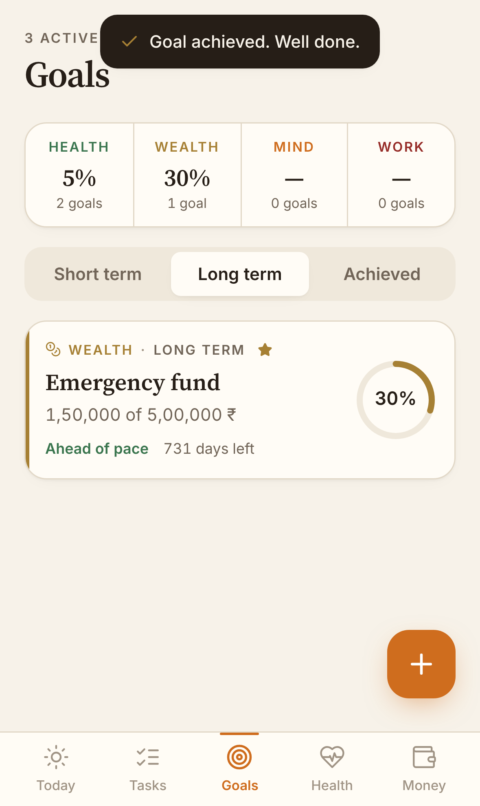
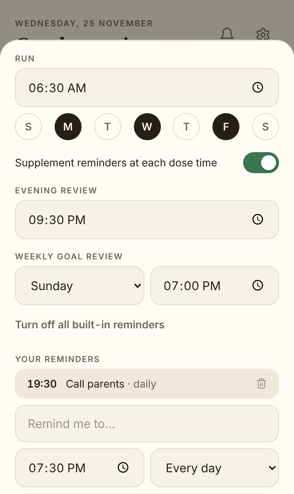
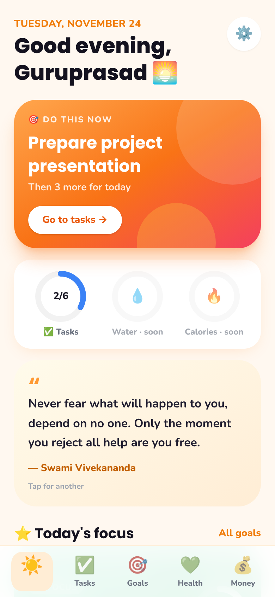

# 🌅 Arise — a personal life planner

> “Arise, awake, and stop not till the goal is reached.” — Swami Vivekananda

Arise is a phone app that helps you set goals, act on them every day and stay focused.
It is a **Progressive Web App (PWA)**: you open it once in your phone's browser, add it to your
home screen, and from then on it opens like a normal app, works offline, and needs no app store.

**Open the app:** https://freespeedindia.github.io/arise/

All your data is stored **only on your phone** (in the browser's private storage). Nothing is sent anywhere.

| Today | Health | Goals | Reminders | Dark mode |
|---|---|---|---|---|
|  |  |  |  |  |

---|---|---|---|---|
|  |  |  |  |  |

---

## 📲 Install it on your phone

### Android (Chrome)
1. Open **https://freespeedindia.github.io/arise/** in **Chrome**.
2. Tap the **⋮** menu (top right) → **Install app** (or **Add to Home screen**).
3. Tap **Install**. The Arise icon appears on your home screen.

### iPhone (Safari)
1. Open **https://freespeedindia.github.io/arise/** in **Safari** (it must be Safari).
2. Tap the **Share** button (the square with an arrow pointing up).
3. Scroll down and tap **Add to Home Screen** → **Add**.

Open Arise from the home screen icon from now on. It works without internet.

> ⚠️ Your data lives inside the installed app on that phone. If you delete the app or clear
> the browser's data, your entries are lost. Cloud backup comes in Phase 4.

---

## What's inside (version 0.2)

- **Today** — the single next action, daily summary (tasks, water, calories, doses), one-tap logging, next reminder, alerts (low stock, goals behind pace), focus goal, today's tasks and a thought from Swami Vivekananda.
- **Tasks** — one-off, daily, weekly and monthly tasks with priority, due date, reminder time, checklists and streaks.
- **Goals** — short and long-term goals in Health (green), Wealth (gold), Mind (saffron) and Work (deep red), with targets that can go up or down, milestones and on-pace tracking. Health goals can update themselves from your weight, runs or workouts.
- **Health** — weight plan with a chart of actual vs plan, BMI, calories with recent foods, water quick-add, activity log with pace, supplements with dose ticks and low-stock warnings.
- **Reminders** — water every 1–2 hours in waking hours, run days, each supplement dose, timed tasks, evening review, weekly goal review and your own reminders.
- **Backup** — save and restore a backup file from Settings.

Design: matte saffron, gold, cream, deep red and green; Inter and Source Serif; line icons; light and dark mode.

**About reminders:** phone notifications arrive while Arise is open or recently used. Reminders that arrive when the app is fully closed need a small server and come with cloud sync in Phase 4.

## 🗺️ Roadmap

| Phase | What |
|---|---|
| 1 ✅ | App shell, Today, Tasks, Goals, quotes, install on phone |
| 2 ✅ | Health (weight plan & chart, calories, water), runs, supplements, phone reminders |
| 3 | Money: expenses, budget, income, investments, charts |
| 4 | Email reminders & summaries, cloud sync, daily/weekly/monthly reviews, focus mode |

---

## 🛠️ For developers

Stack: React + TypeScript + Vite, Tailwind CSS, Framer Motion, Recharts, lucide icons, Dexie (IndexedDB), vite-plugin-pwa.

Tests: `npx vitest run` (logic, incl. 2-year schedules). `tests/e2e-phone.cjs` clicks through the whole app on iPhone and Android screen sizes with Playwright.

```bash
npm install
npm run dev      # local development at http://localhost:5173
npm run build    # production build in dist/
```

Every push to `main` builds and deploys to GitHub Pages (`.github/workflows/deploy.yml`).
Never commit secrets — use environment variables (`.env` is git-ignored).

Quotes live in `src/data/quotes.ts`. Only add quotes you have checked in *The Complete Works of Swami Vivekananda*.
