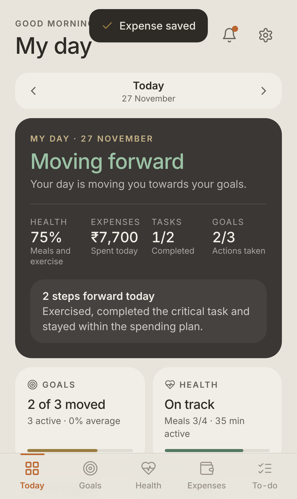
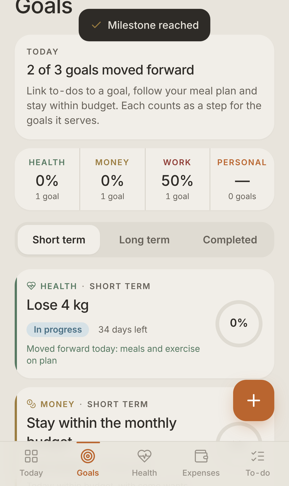
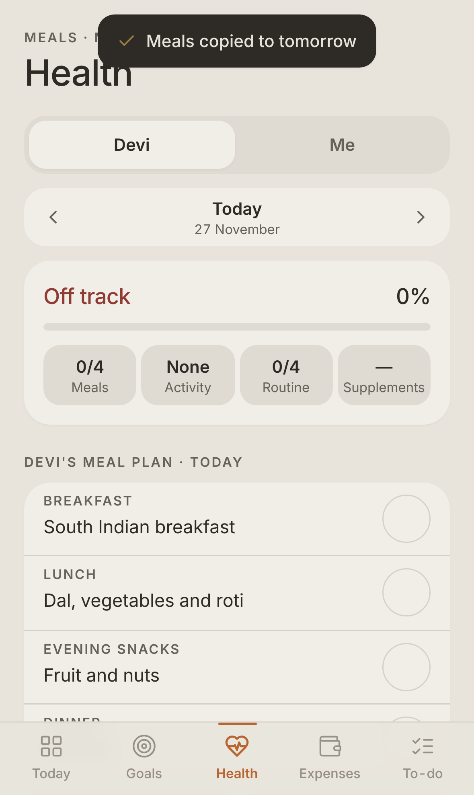
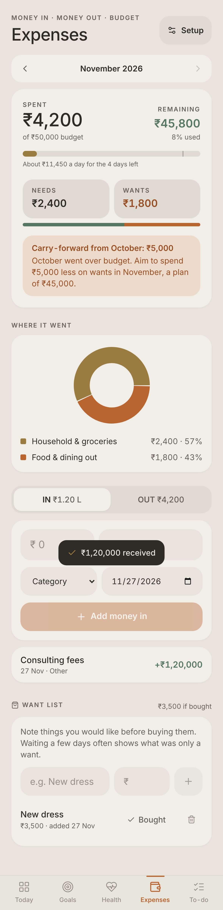
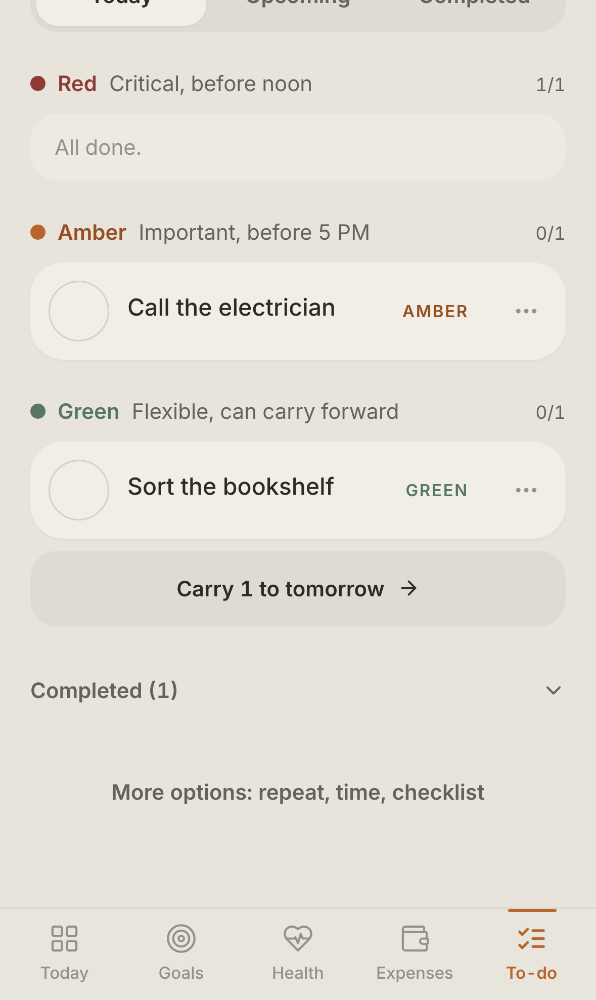
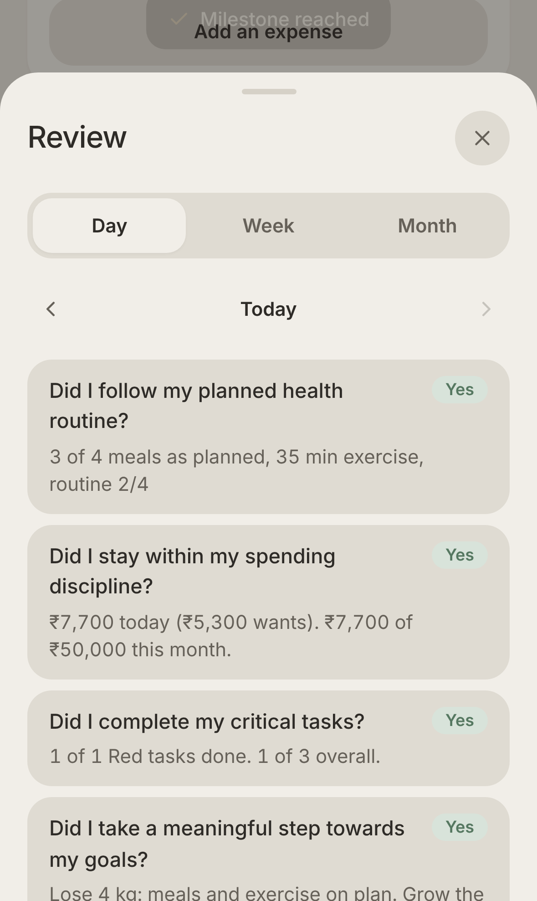

# Arise — a personal life planner

> "Arise, awake, and stop not till the goal is reached." — Swami Vivekananda

Arise is a phone app that helps you set goals, act on them every day and stay focused.
It is a **Progressive Web App (PWA)**: you open it once in your phone's browser, add it to your
home screen, and from then on it opens like a normal app, works offline, and needs no app store.

**Open the app:** https://freespeedindia.github.io/arise/

All your data is stored **only on your phone** (in the browser's private storage). Nothing is sent anywhere.

| My day | Goals | Health | Expenses | To-do | Daily review |
|---|---|---|---|---|---|
|  |  |  |  |  |  |

---

## Install it on your phone

### Android (Chrome)
1. Open **https://freespeedindia.github.io/arise/** in **Chrome**.
2. Tap the menu (three dots, top right), then **Install app** (or **Add to Home screen**).
3. Tap **Install**. The Arise icon appears on your home screen.

### iPhone (Safari)
1. Open **https://freespeedindia.github.io/arise/** in **Safari** (it must be Safari).
2. Tap the **Share** button (the square with an arrow pointing up).
3. Scroll down and tap **Add to Home Screen**, then **Add**.

Open Arise from the home screen icon from now on. It works without internet.

### iPhone app (Xcode)
The `ios/` folder is Arise as a native iPhone app. In this version, reminders arrive even when the app is closed. See **[IPHONE.md](IPHONE.md)** for the steps: open it in Xcode, sign in with your Apple ID, and press Play.

> Your data lives inside the installed app on that phone. If you delete the app or clear
> the browser's data, your entries are lost. Use Settings, Save backup now and then.

---

## What's inside (version 0.7)

Arise is a daily operating system: Goals are the brain, and Health, Expenses and the To-do list are the arms that carry them out. Everything is meant to be updated in about five minutes each morning.

- **My day (dashboard)** — a date selector to plan tomorrow or look back, and a daily alignment card: Moving forward, On track or Drifting, with Health %, money spent, tasks done and goals moved. Below it, the four areas, both meal plans, money in and out for the month, and Red, Amber and Green progress. Every number comes from what you recorded; an empty day is not judged.
- **Goals** — short term (this month or next) and long term (six months or more), with target, deadline, progress and milestones. Status is Not started, In progress, On track, At risk or Completed, worked out from real progress or set by you. Each goal shows whether today moved it forward: linked to-dos, milestones, following the meal plan (Health goals) or staying within budget (Money goals).
- **Health** — tabs for Devi and Me. A simple meal plan (breakfast, lunch, evening snacks, dinner) as plain words, copied between Devi and Me or to the next day, ticked when followed. Exercise or play in minutes, an editable daily routine, supplements per person, optional water and weight. A daily "stayed on track" indicator.
- **Expenses** — IN and OUT tabs in rupees, Need or Want on every expense, editable categories, a want list that turns into an expense when bought, a monthly budget with spent, remaining, % used, needs and wants, a category chart, and a visible carry-forward when a month goes over.
- **To-do** — Red (critical, before noon), Amber (before 5 PM) and Green (flexible). Quick add, tick, move between colours, carry unfinished Green to tomorrow, link to a goal, completed and upcoming views. Phone nudges at 11:30 and 16:30 if Red or Amber items are open.
- **Reviews** — the daily review answers four questions from your data (health routine, spending discipline, critical tasks, a step towards a goal). Weekly and monthly overviews show days forward or drifting, health average, meals followed, Red task completion, needs, wants, overspending and missed critical tasks.
- **Also kept** — Documents with expiry reminders and PIN lock, Focus mode, reminders, PDF and Excel export, and backup. Documents and Focus open from Settings.

Older investment, net worth, loan and calorie entries are kept safely in the backup file but no longer shown.

Design: matte saffron, gold, cream, deep red and green; Inter and Source Serif; line icons; light and dark mode.

**About reminders:** phone notifications arrive while Arise is open or recently used. There is no email or server component.

## Roadmap

| Phase | What |
|---|---|
| 1 (done) | App shell, Today, Tasks, Goals, quotes, install on phone |
| 2 (done) | Health, runs, supplements, phone reminders, professional redesign |
| 3 (done) | Money, investments, net worth, Wealth goals |
| 4 (done) | Reviews, focus mode, PDF and Excel export |
| 0.7 (done) | Refined into a daily operating system: goals linked to health, expenses and Red/Amber/Green to-dos |

---

## For developers

Stack: React + TypeScript + Vite, Tailwind CSS, Framer Motion, Recharts, lucide icons, Dexie (IndexedDB), vite-plugin-pwa. Export uses jsPDF, jspdf-autotable and write-excel-file, loaded only when you export.

iPhone app: Capacitor 7 with Swift Package Manager. `node scripts/build-ios.mjs` rebuilds the web app, syncs it into `ios/`, and copies the plugin code into `ios/App/CapApp-SPM/Plugins`, so the Mac needs only Xcode. Add `--zip <dir>` to write the zip. The native-only code is in `src/lib/native.ts`: iOS local notifications booked 3 days ahead, focus alarm, and the share sheet through Filesystem and Share. `tests/native-ios.cjs` checks those paths against a mocked native bridge.

Tests: `npm test` (logic incl. 2-year schedules, money, net worth and reports). `tests/e2e-phone.cjs` clicks through the whole app on iPhone and Android screen sizes with Playwright; `tests/button-audit.cjs` taps every button on every screen and inside every sheet.

```bash
npm install
npm run dev      # local development at http://localhost:5173
npm run build    # production build in dist/
```

Every push to `main` builds and deploys to GitHub Pages (`.github/workflows/deploy.yml`).
Never commit secrets — use environment variables (`.env` is git-ignored).

Quotes live in `src/data/quotes.ts`. Only add quotes you have checked in *The Complete Works of Swami Vivekananda*.
