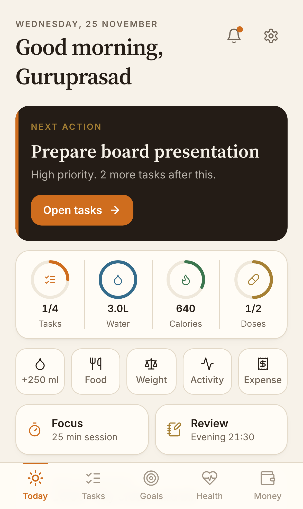
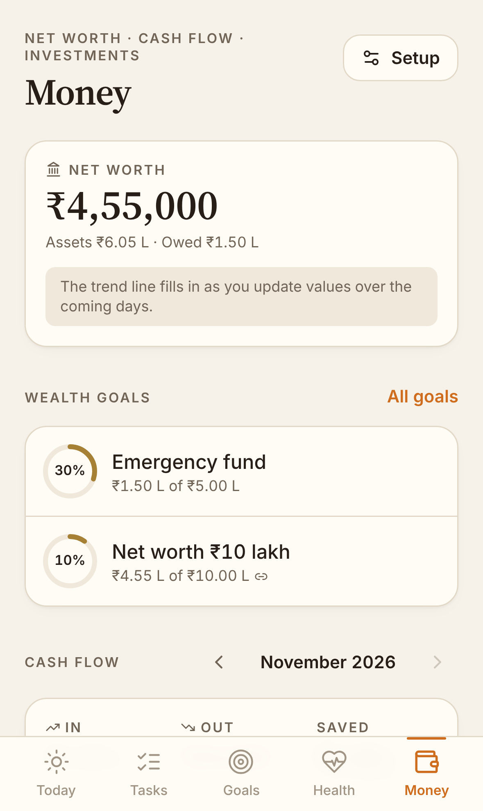
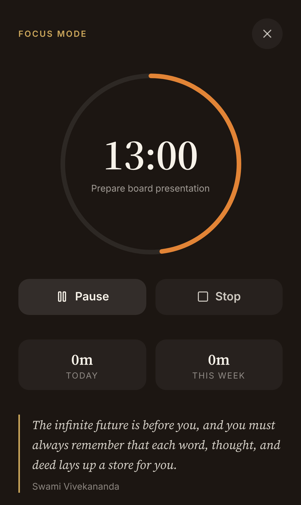
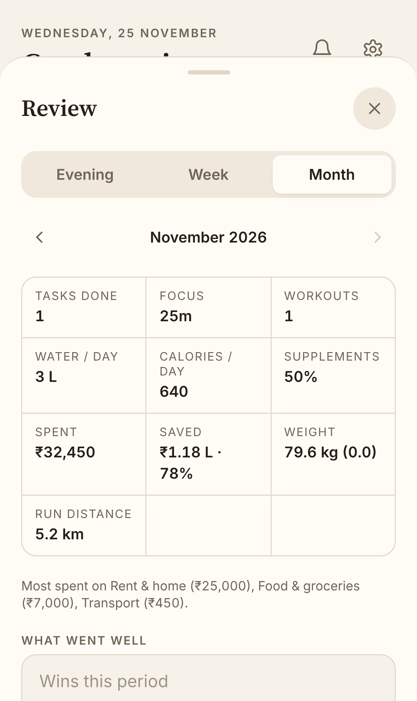
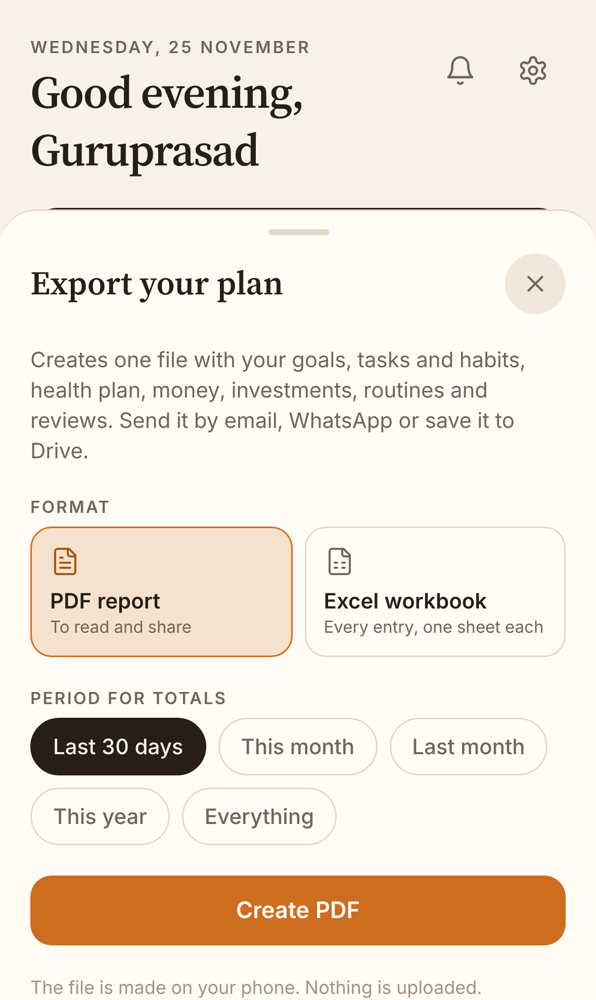
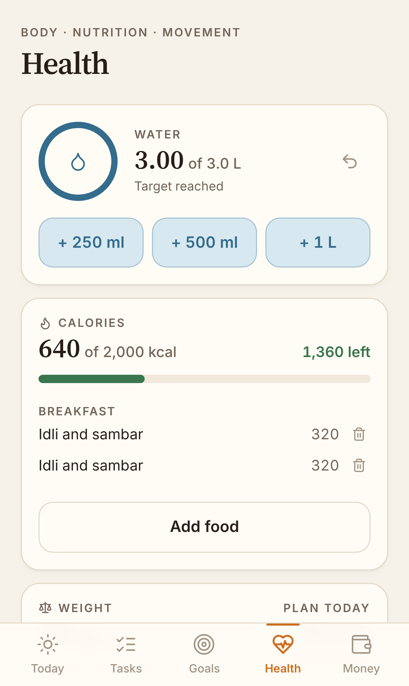
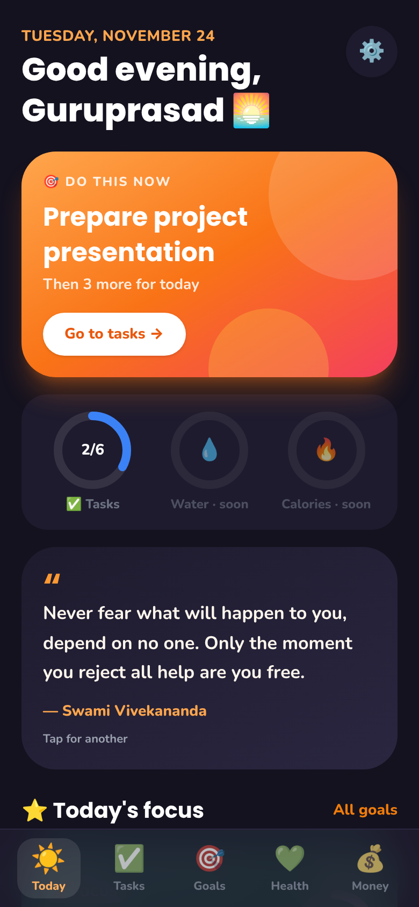
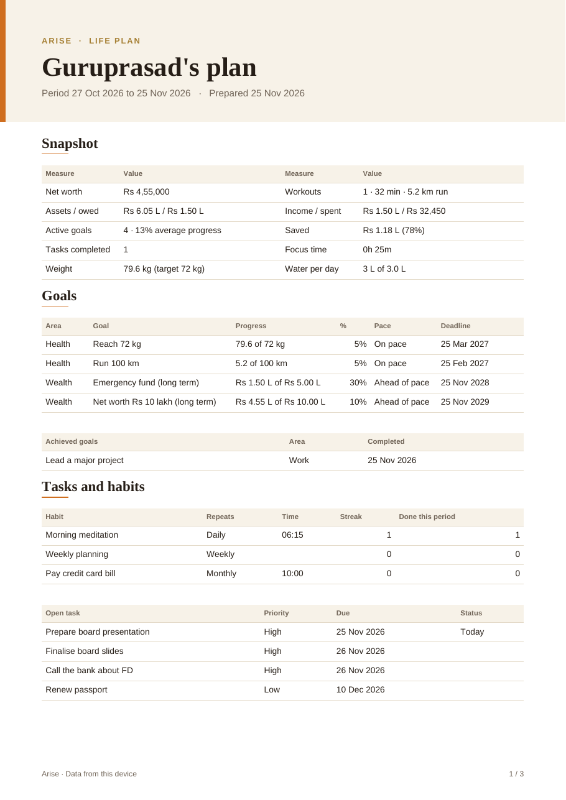

# Arise — a personal life planner

> "Arise, awake, and stop not till the goal is reached." — Swami Vivekananda

Arise is a phone app that helps you set goals, act on them every day and stay focused.
It is a **Progressive Web App (PWA)**: you open it once in your phone's browser, add it to your
home screen, and from then on it opens like a normal app, works offline, and needs no app store.

**Open the app:** https://freespeedindia.github.io/arise/

All your data is stored **only on your phone** (in the browser's private storage). Nothing is sent anywhere.

| Today | Money | Focus | Monthly review | Export |
|---|---|---|---|---|
|  |  |  |  |  |

| Health | Goals | Reminders | Dark mode | PDF report |
|---|---|---|---|---|
|  |  |  |  |  |

---

## Install it on your phone

### Android (Chrome)
1. Open **https://freespeedindia.github.io/arise/** in **Chrome**.
2. Tap the menu (three dots, top right), then **Install app** (or **Add to Home screen**).
3. Tap **Install**. The Arise icon appears on your home screen.

### iPhone (Safari)
1. Open **https://freespeedindia.github.io/arise/** in **Safari** (it must be Safari).
2. Tap the **Share** button (the square with an arrow pointing up).
3. Scroll down and tap **Add to Home Screen**, then **Add**.

Open Arise from the home screen icon from now on. It works without internet.

> Your data lives inside the installed app on that phone. If you delete the app or clear
> the browser's data, your entries are lost. Use Settings, Save backup now and then.

---

## What's inside (version 0.3)

- **Today** — the single next action, daily summary, one-tap logging (water, food, weight, activity, expense), focus and review shortcuts, next reminder, alerts (low stock, goals behind pace, spending over a limit), focus goal, today's tasks and a thought from Swami Vivekananda.
- **Tasks** — one-off, daily, weekly and monthly tasks with priority, due date, reminder time, checklists and streaks.
- **Goals** — short and long-term goals in Health, Wealth, Mind and Work, with targets that go up or down, milestones and on-pace tracking. Goals can update themselves: Health from weight, runs or workouts; Wealth from net worth, total investments, money saved or one investment; Mind and Work from focus hours.
- **Health** — weight plan with chart, BMI, calories, water, activity log with pace, supplements with dose ticks and low-stock warnings.
- **Money** — net worth with a trend line, income and expenses by month, savings rate, a monthly spending limit and limits per category, assets and investments with gain or loss and allocation, loans and EMIs. Categories, asset types, budgets and currency are all yours to edit in Money, Setup.
- **Focus mode** — a full-screen timer (15 to 60 minutes, optional break) tied to a task, a short "before you start" list (Do Not Disturb, social media closed), and a log of focus time. The timer keeps running if you leave the app.
- **Reviews** — evening review (energy, what went well, what to improve, tomorrow's top three, which become tasks), weekly and monthly reviews with every module's numbers.
- **Export and share** — the complete plan as a PDF report or an Excel workbook (one sheet per area), shared through the phone's share sheet to email, WhatsApp, Drive or any app. Made on the phone; nothing is uploaded.
- **Reminders** — water through waking hours, run days, supplement doses, timed tasks, evening review, weekly review and your own reminders.
- **Backup** — save and restore a backup file from Settings.

Design: matte saffron, gold, cream, deep red and green; Inter and Source Serif; line icons; light and dark mode.

**About reminders:** phone notifications arrive while Arise is open or recently used. There is no email or server component.

## Roadmap

| Phase | What |
|---|---|
| 1 (done) | App shell, Today, Tasks, Goals, quotes, install on phone |
| 2 (done) | Health, runs, supplements, phone reminders, professional redesign |
| 3 (done) | Money, investments, net worth, Wealth goals |
| 4 (done) | Reviews, focus mode, PDF and Excel export |

---

## For developers

Stack: React + TypeScript + Vite, Tailwind CSS, Framer Motion, Recharts, lucide icons, Dexie (IndexedDB), vite-plugin-pwa. Export uses jsPDF, jspdf-autotable and write-excel-file, loaded only when you export.

Tests: `npm test` (logic incl. 2-year schedules, money, net worth and reports). `tests/e2e-phone.cjs` clicks through the whole app on iPhone and Android screen sizes with Playwright.

```bash
npm install
npm run dev      # local development at http://localhost:5173
npm run build    # production build in dist/
```

Every push to `main` builds and deploys to GitHub Pages (`.github/workflows/deploy.yml`).
Never commit secrets — use environment variables (`.env` is git-ignored).

Quotes live in `src/data/quotes.ts`. Only add quotes you have checked in *The Complete Works of Swami Vivekananda*.
