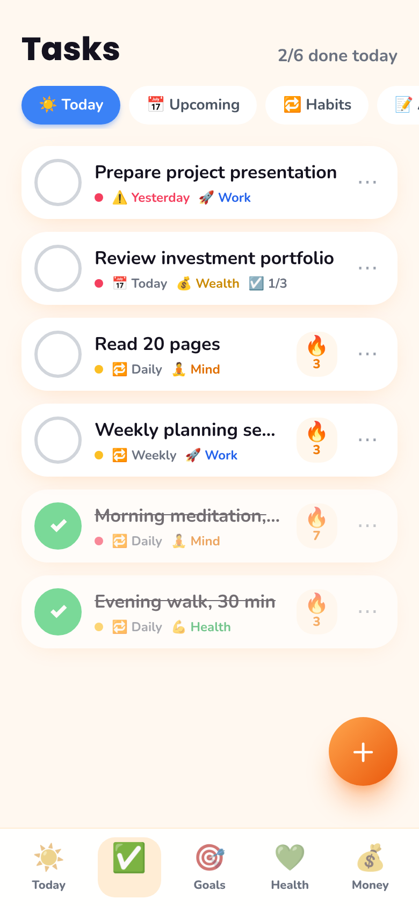
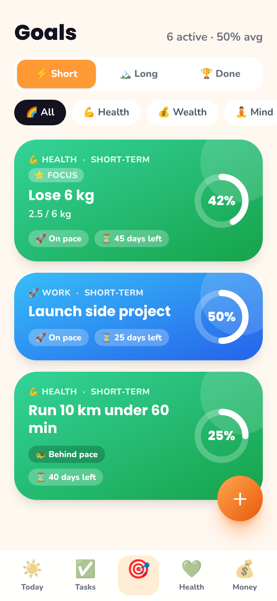
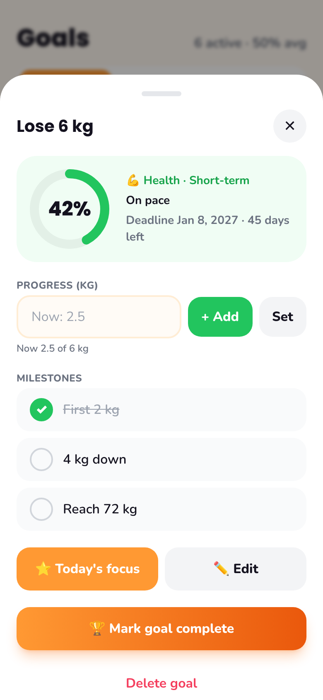

# 🌅 Arise — a personal life planner

> “Arise, awake, and stop not till the goal is reached.” — Swami Vivekananda

Arise is a phone app that helps you set goals, act on them every day and stay focused.
It is a **Progressive Web App (PWA)**: you open it once in your phone's browser, add it to your
home screen, and from then on it opens like a normal app, works offline, and needs no app store.

**Open the app:** https://freespeedindia.github.io/arise/

All your data is stored **only on your phone** (in the browser's private storage). Nothing is sent anywhere.

| Today | Tasks | Goals | Goal detail | Dark mode |
|---|---|---|---|---|
|  |  |  |  |  |

---

## 📲 Install it on your phone

### Android (Chrome)
1. Open **https://freespeedindia.github.io/arise/** in **Chrome**.
2. Tap the **⋮** menu (top right) → **Install app** (or **Add to Home screen**).
3. Tap **Install**. The Arise icon appears on your home screen.

### iPhone (Safari)
1. Open **https://freespeedindia.github.io/arise/** in **Safari** (it must be Safari).
2. Tap the **Share** button (the square with an arrow pointing up).
3. Scroll down and tap **Add to Home Screen** → **Add**.

Open Arise from the home screen icon from now on. It works without internet.

> ⚠️ Your data lives inside the installed app on that phone. If you delete the app or clear
> the browser's data, your entries are lost. Cloud backup comes in Phase 4.

---

## ✨ What's in Phase 1

- **Today dashboard** — greeting, “Do this now” (the single most important thing), task progress ring,
  a Vivekananda quote, your focus goal and today's tasks.
- **Tasks** — one-off, daily, weekly and monthly tasks, with priority, due date, checklists and 🔥 streaks.
- **Goals** — short-term and long-term goals in four areas: 💪 Health (green), 💰 Wealth (gold),
  🧘 Mind (saffron), 🚀 Work (blue). Each has a deadline, optional number target and milestones,
  percent complete, and whether you are on pace. Confetti when you finish one 🎉.
- **116 quotes** of Swami Vivekananda from *The Complete Works*, one per day (tap for another).
- Light and dark mode, big buttons, one-hand use.

## 🗺️ Roadmap

| Phase | What |
|---|---|
| 1 ✅ | App shell, Today, Tasks, Goals, quotes, install on phone |
| 2 | Health (weight plan & chart, calories, water), runs, supplements, phone reminders |
| 3 | Money: expenses, budget, income, investments, charts |
| 4 | Email reminders & summaries, cloud sync, daily/weekly/monthly reviews, focus mode |

---

## 🛠️ For developers

Stack: React + TypeScript + Vite, Tailwind CSS, Framer Motion, Dexie (IndexedDB), vite-plugin-pwa.

```bash
npm install
npm run dev      # local development at http://localhost:5173
npm run build    # production build in dist/
```

Every push to `main` builds and deploys to GitHub Pages (`.github/workflows/deploy.yml`).
Never commit secrets — use environment variables (`.env` is git-ignored).

Quotes live in `src/data/quotes.ts`. Only add quotes you have checked in *The Complete Works of Swami Vivekananda*.
